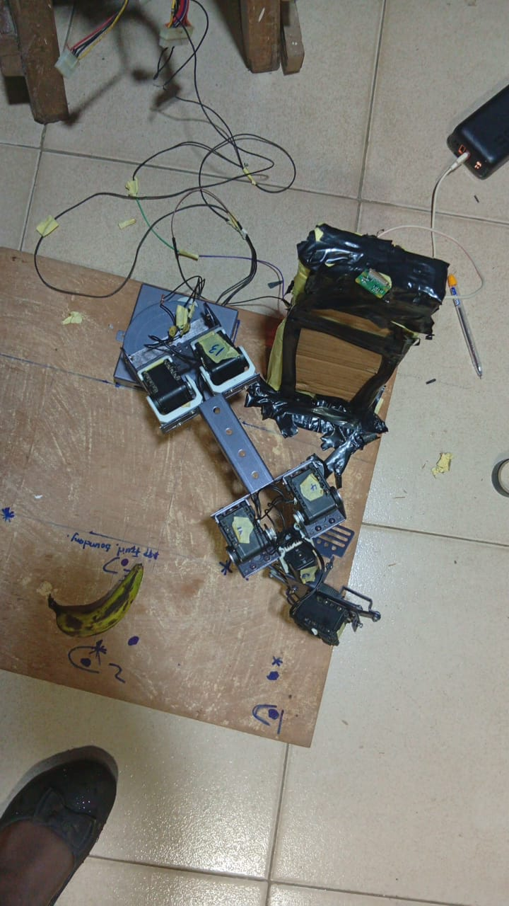
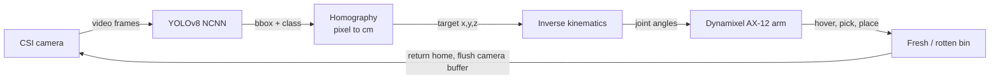
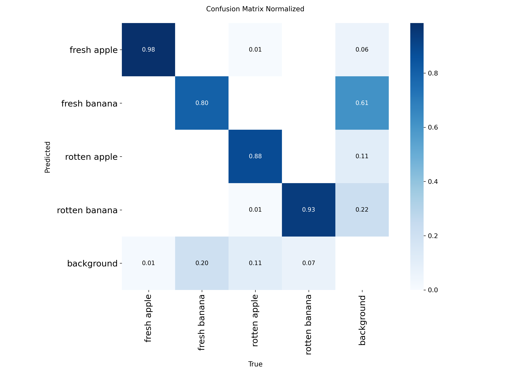
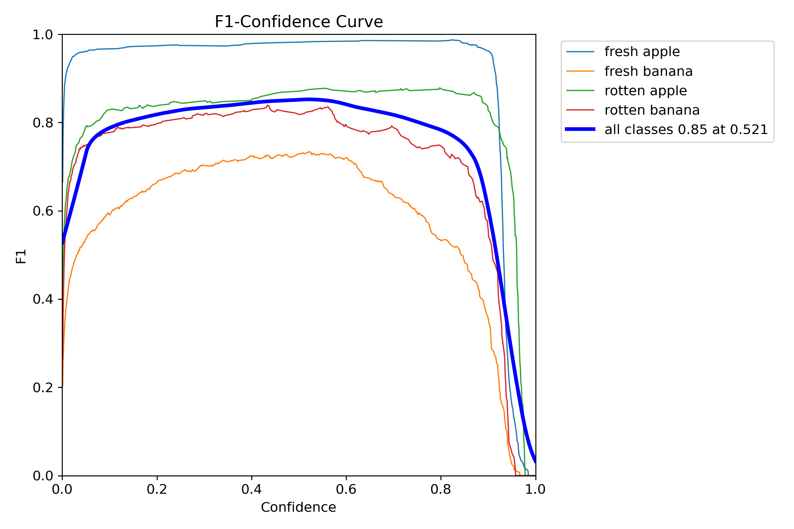
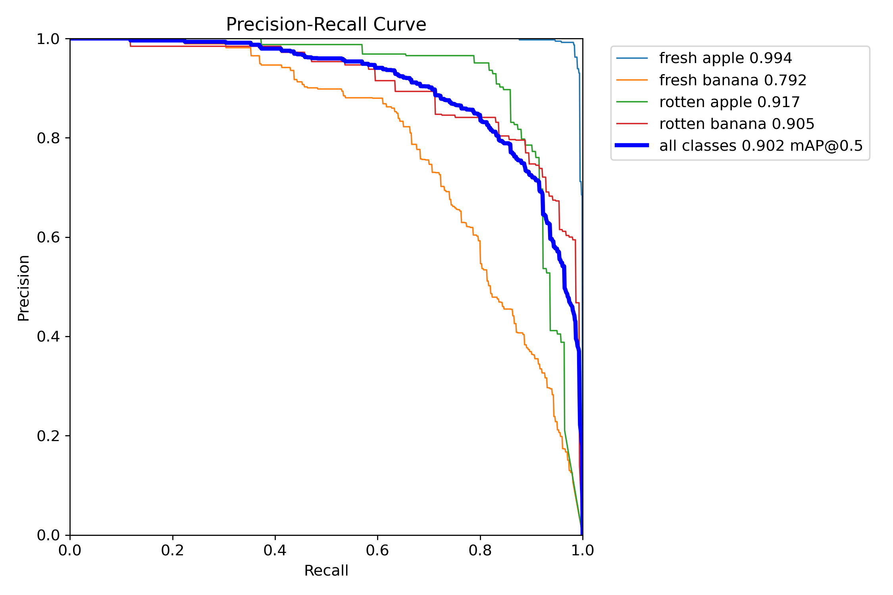
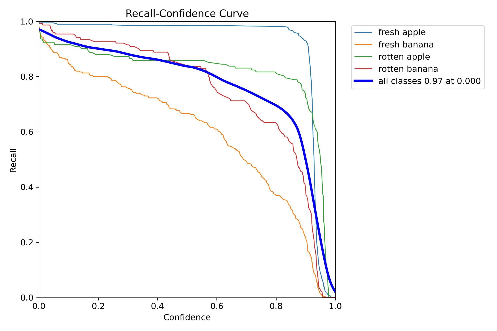
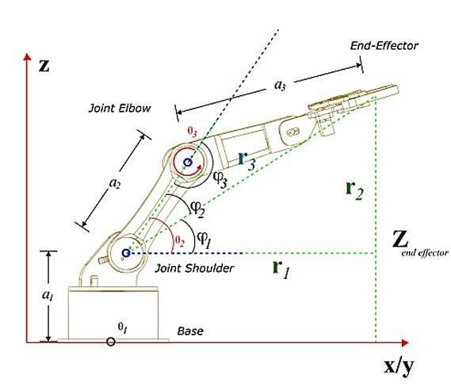
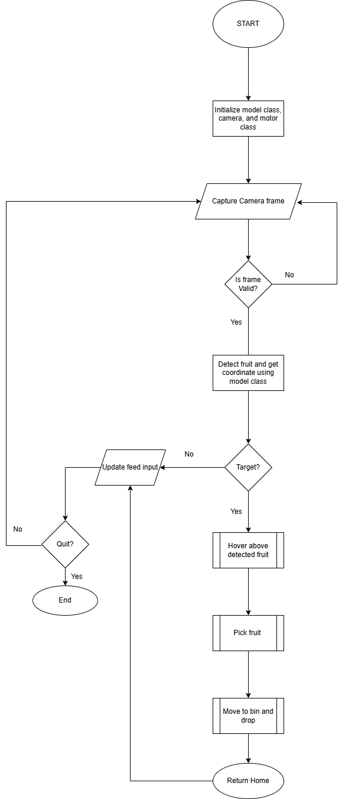

# Automated Fruit Sorting Robotic Arm Using Computer Vision

A low-cost robotic arm that **detects fresh vs. rotten fruit (apples and bananas) with YOLOv8, converts the detection to real-world coordinates with a homography, solves geometric inverse kinematics, and drives a chain of Dynamixel AX-12 servos to pick the fruit and drop it in the correct bin.**

> Group Design project (EEE 357), Department of Electronic and Electrical Engineering, Faculty of Technology, Obafemi Awolowo University, Ile-Ife, Nigeria.
> Supervisor: Prof. K. P. Ayodele



---

## Table of contents

1. [Motivation and problem](#1-motivation-and-problem)
2. [Aim and objectives](#2-aim-and-objectives)
3. [System overview](#3-system-overview)
4. [Hardware](#4-hardware)
5. [Computer vision pipeline](#5-computer-vision-pipeline)
6. [Inverse kinematics](#6-inverse-kinematics)
7. [Software and control flow](#7-software-and-control-flow)
8. [Results and findings](#8-results-and-findings)
9. [Limitations](#9-limitations)
10. [Future work](#10-future-work)
11. [Repository layout and how to run](#11-repository-layout-and-how-to-run)
12. [Related work and references](#12-related-work-and-references)
13. [Team](#13-team)

---

## 1. Motivation and problem

Roughly one-third of food produced for human consumption is lost or wasted globally (FAO, 2011), and losses of fruit and vegetables reach **30–40 % in developing regions** because of poor post-harvest handling and sorting. Rotten fruit also spreads decay to the fresh produce around it.

Sorting is still mostly manual. Human sorting is slow, physically demanding and inconsistent: fatigue, subjective judgement and poor working conditions mean good fruit gets discarded and spoiled fruit slips through. Affordable intelligent sorting systems are scarce for small farmers.

## 2. Aim and objectives

**Aim:** build an automated sorting system that combines computer vision with a robotic arm to classify and physically separate fresh and rotten fruit.

**Objectives**

1. Implement a YOLOv8n model for real-time detection and classification of selected fruits.
2. Extract each fruit's position in the camera's field of view and convert it to real-world coordinates.
3. Use that position to compute joint angles for the Dynamixel servos so the arm can locate, grasp and deposit the fruit in the right bin.

## 3. System overview



Two classes of fruit (apple, banana) × two conditions (fresh, rotten) give **four detection classes**: `fresh apple`, `fresh banana`, `rotten apple`, `rotten banana`. The first letter of the label (`f` / `r`) selects the destination bin.

## 4. Hardware

| Subsystem | Component | Purpose |
|---|---|---|
| Main controller | Raspberry Pi 4 Model B | Runs inference, IK and servo control |
| Vision | Raspberry Pi Camera Module 3 (CSI) with continuous autofocus | Captures frames |
| Actuators | 7 × Dynamixel AX-12 smart servos, daisy-chained | Base, shoulder (2), elbow (2), wrist, gripper |
| Bus interface | ROBOTIS U2D2 | Converts Pi full-duplex UART/USB to the half-duplex Dynamixel TTL bus |
| Arm power | 12 V switched-mode power supply (SMPS) via a power hub | Stable VDD/GND for the servos |
| Logic power | Separate 5 V power pack for the Pi | Isolates the processor from motor noise |

**Power design.** The servo and logic supplies are separate so back-EMF and EMI from the high-torque actuators do not disturb the Raspberry Pi. An SMPS keeps the servo voltage stable and avoids the sag typical of linear supplies.

**Servo IDs** (as used in the code): base `9`, shoulder `11` and `13` (mirrored pair), elbow `4` and `5` (mirrored pair), wrist `6`, gripper `8`. Mirrored pairs receive complementary positions (`goal` and `1023 − goal`).

**Arm geometry used in the IK model**

| Link | Meaning | Length |
|---|---|---|
| a₁ | Base to shoulder joint (height) | 15.0 cm |
| a₂ | Shoulder to elbow | 17.2 cm |
| a₃ | Elbow to gripper tip | 23.5 cm |

## 5. Computer vision pipeline

1. **Model inference.** An NCNN-optimised YOLOv8 model (Ultralytics) runs on frames from the CSI camera and predicts bounding boxes and class labels.
2. **Homography.** A 3 × 3 matrix **H** maps a pixel centre (cx, cy) to world coordinates (x_w, y_w) in centimetres from the robot base. H is calculated from calibration points on the work surface.
3. **Orientation.** For asymmetric fruit (bananas) the bounding-box angle is computed with an arctangent of its dimensions so the wrist servo (ID 6) can align with the fruit.

### Model training and validation

Trained with Ultralytics YOLOv8 on a **custom dataset of 497 images containing 984 fruit instances**. F1 is the harmonic mean of precision (P) and recall (R):

```
F1 = 2·P·R / (P + R)
```

| Class | Precision | Recall | mAP50 | F1 |
|---|---|---|---|---|
| **All classes** | 0.876 | 0.836 | **0.902** | 0.855 |
| Fresh apple | 0.982 | 0.985 | 0.994 | 0.983 |
| Fresh banana | 0.819 | 0.663 | 0.792 | 0.733 |
| Rotten apple | 0.891 | 0.859 | 0.917 | 0.875 |
| Rotten banana | 0.812 | 0.837 | 0.905 | 0.824 |



**Curves**

| F1 vs confidence | Precision vs recall | Recall vs confidence |
|---|---|---|
|  |  |  |

Key readings:

- **Peak F1 = 0.85 at a confidence of 0.521**, which is used as the operating threshold in the sorting logic.
- Fresh apple is nearly perfect (mAP50 0.994).
- **Fresh banana is the weak class** (recall 0.663, mAP50 0.792). In the confusion matrix, about 20 % of true fresh bananas were predicted as background (missed), and most background false positives were labelled fresh banana. Bananas vary more in pose and shape than apples.
- Recall reaches 0.97 at very low confidence thresholds, so few fruits are missed outright if the threshold is lowered, at the cost of more false positives.

## 6. Inverse kinematics

A geometric (law-of-cosines) solution for a 3-link arm. The model follows the geometric approach of Al Tahtawi et al. (2021), also used in the AX-12A study by Widyacandra et al. (2022).



Given a target (x, y, z) in cm:

**Base rotation**

```
θ1 = atan2(y, x)
```

**Planar reach and height** (relative to the shoulder joint)

```
r1 = √(x² + y²)
r2 = z − a1
r3 = √(r1² + r2²)          # shoulder-to-tip distance
```

**Elbow** (law of cosines on the triangle a₂, a₃, r₃)

```
φ3 = arccos( (a2² + a3² − r3²) / (2·a2·a3) )
θ3 = 180° − φ3
```

**Shoulder**

```
φ1 = atan2(r2, r1)
φ2 = arccos( (a2² + r3² − a3²) / (2·a2·r3) )
θ2 = φ1 + φ2
```

A target is reachable only if `|a2 − a3| ≤ r3 ≤ a2 + a3` (about 6.3 cm to 40.7 cm for this arm).

**Mapping to servo positions.** AX-12 servos cover 300° over positions 0–1023 (≈ 0.29° per step), so `steps = angle / 300 × 1023`. Each joint has a calibration offset that maps the IK angle onto the servo's range: base **+90°**, shoulder **+138°**, elbow **+150°**.

## 7. Software and control flow

Written in Python. The loop is:

1. **Initialise**: load the YOLOv8 model, start the camera, connect to the Dynamixel bus, send the arm to its default pose.
2. **Detect**: capture a frame, run YOLO; if a fruit is found, map its pixel centre to world coordinates with the homography.
3. **Execute (state machine)**
   - **Hover** at a safe height (Z = 15 cm) above the target.
   - **Pick**: lower to 5 cm and close the gripper.
   - **Place**: lift and move to the pre-programmed bin (rotten or fresh), open the gripper.
4. **Return home** and **flush the camera buffer** so the next cycle uses a fresh frame instead of a stale one.



## 8. Results and findings

**What worked**

- The integrated pipeline (detect → map → IK → actuate) ran end-to-end on a Raspberry Pi 4 and **sorted apples and bananas into separate bins**.
- The homography guided the end-effector to the target coordinates.
- The detector reached **mAP50 0.902** overall; apples were classified very reliably.
- Low-cost, off-the-shelf hardware (Pi, AX-12 servos, SMPS) was enough for a working proof of concept.
- The report quotes an inference time of **2.4 ms per image**.

**What limited performance**

- **Speed.** Overall detect-and-sort cycle time was slow compared with industrial systems. Part of this is the fixed `time.sleep(5)` after each joint move.
- **Orientation sensitivity.** Irregularly placed fruit sometimes led to awkward grip angles and small placement errors.
- **Gripper dynamics.** Fruit is fragile, so the claw has to balance force: too much bruises, too little lets the fruit slip.
- **Structured environment assumed.** Fruit is placed at predictable positions. Real produce arrives in random clusters with occlusion and overlap.
- **Weak banana detection.** Fresh banana recall (0.663) was the main classification weakness.

**Honest scope note.** End-to-end results were evaluated qualitatively in live tests. A quantitative evaluation (pick success rate, placement error in cm, cycle time per fruit, sorting accuracy over N trials) is the most valuable thing to add. See [Future work](#10-future-work).

## 9. Limitations

- Only two fruit types (apples, bananas); different shapes, weights and skin friction need different end-effector settings.
- No depth sensor (no LIDAR or RGB-D). The homography only maps points on a flat work surface and must be **manually recalibrated** when the camera position or lighting changes.
- Rigid claw gripper; risk of bruising delicate fruit.
- Vision is sensitive to ambient lighting ("colour shift" affecting ripeness classification).
- Small dataset (497 images).

## 10. Future work

- **Quantitative system evaluation**: sorting accuracy, pick success rate, positional error and throughput.
- **Soft or under-actuated gripper** (silicone or compliant foam) to avoid point-pressure bruising.
- **Controlled lighting**: a shroud with a fixed LED ring for consistent colour data.
- **Hardware acceleration**: an Edge TPU (e.g. Google Coral USB Accelerator) to raise FPS and cut latency.
- **Instance segmentation** (e.g. YOLOv8n-seg) for pixel-accurate masks, better grip points and handling of overlapping fruit.
- **Replace fixed sleeps** with servo position feedback, and add trajectory smoothing for faster motion.
- **IoT dashboard**: log sorting statistics to the cloud so farm managers can monitor yield and ripeness ratios.
- Larger, more varied dataset and more fruit classes.

## 11. Repository layout and how to run

```
.
├── README.md
├── requirements.txt
├── src/
│   ├── main.py            # main loop: camera -> vision -> IK -> arm
│   ├── robot_motion.py    # Dynamixel control + inverse kinematics
│   └── robot_vision.py    # YOLOv8 (NCNN) detection + homography
└── docs/
    └── images/            # figures used in this README
```

**Setup (Raspberry Pi OS)**

```bash
sudo apt install -y python3-picamera2 python3-libcamera
python3 -m venv --system-site-packages .venv && source .venv/bin/activate
pip install -r requirements.txt
sudo usermod -aG dialout $USER      # permission for /dev/ttyUSB0 (log out/in)
```

**Run**

```bash
cd src
python3 main.py        # press 'q' in the camera window to stop
```

Place your trained NCNN model folder (`best_ncnn_model/`) next to `main.py`. Before running, calibrate the homography points in `robot_vision.py`, the gripper positions in `robot_motion.py`, and the bin coordinates in `main.py` for your own setup.

## 12. Related work and references

This project builds on, and its IK model is adapted from:

- A. R. Al Tahtawi, M. Agni, T. D. Hendrawati, "Small-scale Robot Arm Design with Pick and Place Mission Based on Inverse Kinematics," *Journal of Robotics and Control*, vol. 2, no. 6, pp. 469–475, 2021.
- A. Widyacandra, A. R. Al Tahtawi, Martin, "Forward and inverse kinematics modeling of 3-DoF AX-12A robotic manipulator," *JITEL*, vol. 2, no. 2, pp. 139–150, 2022. (Reports forward-kinematics error of 1.04 % and inverse-kinematics error of 0.76 % between MATLAB simulation and hardware.)
- Rotten-fruit-sorting robotic arm with a low-complexity CNN for embedded systems (reviewed in the project literature review).

Other references from the project report:

1. FAO, "Global food losses and food waste: Extent, causes and prevention," Rome, 2011.
2. M. Grolleaud, "Post-harvest losses: Discovering the full story," FAO, 2002.
3. J. Redmon, S. Divvala, R. Girshick, A. Farhadi, "You only look once: Unified, real-time object detection," CVPR, 2016.
4. A. Bochkovskiy, C.-Y. Wang, H.-Y. M. Liao, "YOLOv4: Optimal speed and accuracy of object detection," arXiv:2004.10934, 2020.
5. A. Kamilaris, F. X. Prenafeta-Boldú, "Deep learning in agriculture: A survey," *Computers and Electronics in Agriculture*, vol. 147, pp. 70–90, 2018.

## 13. Team

Supervisor: Prof. K. P. Ayodele

Group members: Mary Oluropo, Adenike Adewumi, Ayomide Adedokun, Joseph Adeyemo, Hameed Oyedele, Victor Owolabi, Victor Olatunji

## License

Add a license of your choice (e.g. MIT) with the group's agreement.
